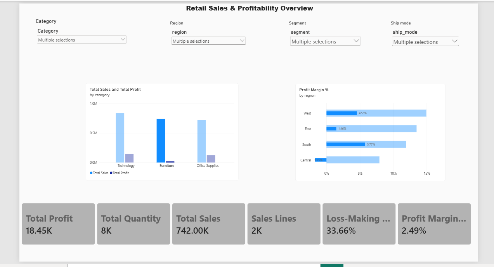
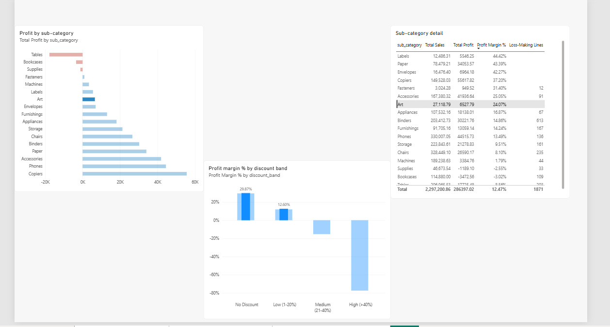
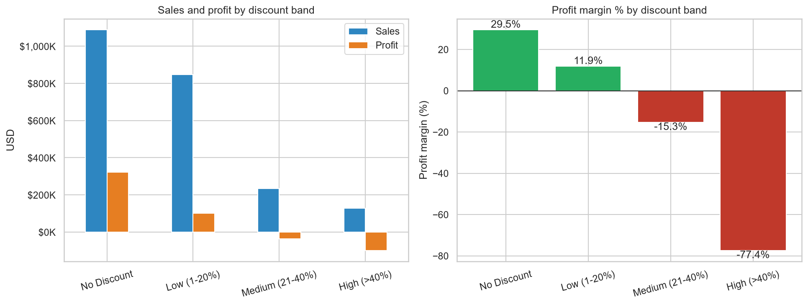
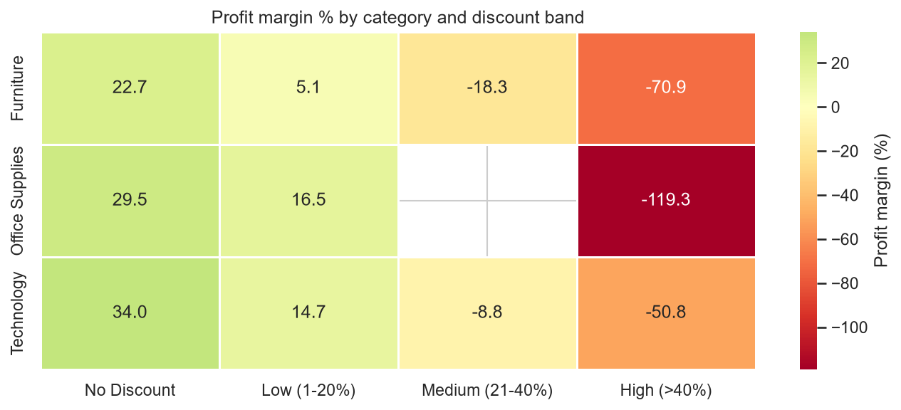
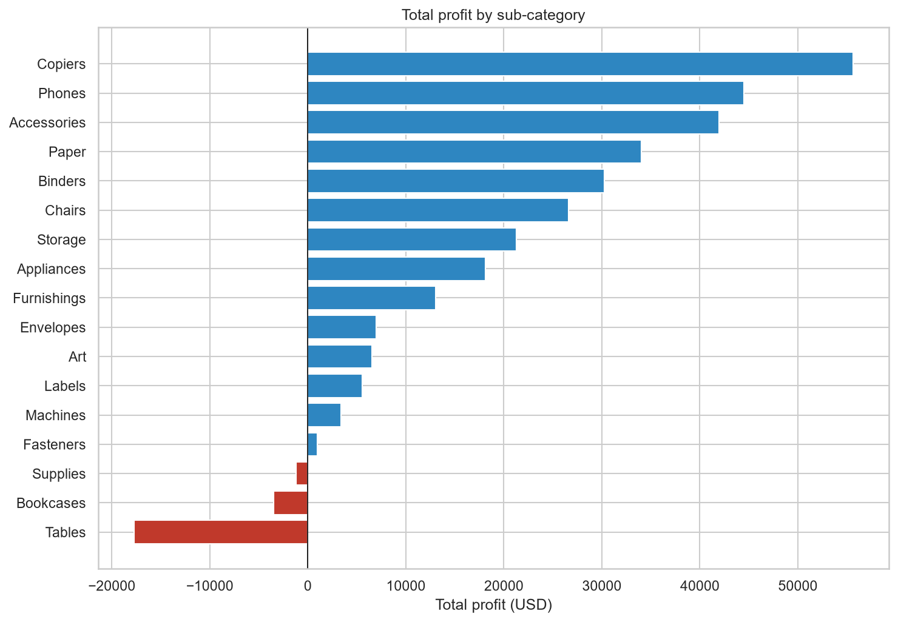

# Retail Sales & Profitability Analytics

An end-to-end analytics project on the Sample Superstore retail dataset, using **Excel, Python, MySQL and Power BI**. The goal is to find where the business makes and loses money, and to recommend actions backed by the data.

> **Author:** [Deekshith1009](https://github.com/Deekshith1009)

---

## 1. Business problem

Management wants to know:

- What are total sales, profit and profit margin?
- Which categories, sub-categories, regions and states perform best and worst?
- Which products lose money?
- How are discounts related to profitability?
- What should management do about it?

## 2. Key findings

All figures are calculated from the dataset and reconciled across all four tools (see section 7). These are **patterns in the data, not proven causes**: the dataset contains no cost data and no dates.

| # | Finding | Evidence |
|---|---|---|
| 1 | Discounts above 20% are strongly associated with losses | Margin by discount band: No Discount **29.51%**, Low (1-20%) **11.91%**, Medium (21-40%) **-15.30%**, High (>40%) **-77.40%**. Medium and High lines are 13.9% of all lines but account for **88.7%** of all money lost on loss-making lines. The pattern holds within each category (correlation between discount and line margin: -0.89 Furniture, -0.88 Office Supplies, -0.76 Technology). |
| 2 | Furniture earns far less per sales dollar | Furniture is 32.3% of sales but 6.4% of profit. Margin is **2.49%** vs 17.04% (Office Supplies) and 17.40% (Technology). 33.7% of Furniture lines lose money. At no discount, Furniture's margin is 22.7%. |
| 3 | Three sub-categories lose money overall | Tables **-17,725**, Bookcases **-3,473**, Supplies **-1,189** (combined -22,387). |
| 4 | Profitable sub-categories can hide large losses | Binders earns +30,222 overall but has a gross loss of -38,511 (40.3% of lines lose money). Machines earns only +3,385 with a gross loss of -30,119. The 10 largest single-line losses all carry discounts of 40% or more. |
| 5 | Central region and four states drive much of the loss | Central: margin **7.92%**, 31.9% of lines lose money, average discount 24.0% (West: 14.94%, 9.9%, 10.9%). Texas, Ohio, Pennsylvania and Illinois together lose 70,869. |
| 6 | Segment and ship mode matter little | Segment margins 11.6%-14.0%; ship-mode margins 12.1%-13.9%. |

Overall: **9,994** sales lines, **2,297,200.86** sales, **286,397.02** profit (**12.47%** margin). Losses on the 1,871 loss-making lines (-156,131.29) offset 35.3% of the profit earned by profitable lines.

### Recommendations

1. Add an approval step for discounts above 20% and **test** a cap on a pilot product group before rolling out. KPI: share of lines with discount above 20%, and their margin.
2. Review Furniture discount rules first (before cost or range changes). KPI: Furniture profit margin.
3. Review Tables and Bookcases pricing; investigate Supplies separately, since it loses money at a low average discount. KPI: margin by sub-category.
4. Review the largest discounted Machines and Binders lines individually. KPI: gross loss by sub-category.
5. Compare discounting practices between Central and West before making any regional change. KPI: margin and average discount by region.

## 3. Dashboard




The Power BI report uses a star-style model: `FactSales` plus `DimProduct`, `DimGeography` and `DimDiscountBand`, with single-direction many-to-one relationships. Margins are DAX measures that divide totals (total profit ÷ total sales). Measures include Total Sales, Total Profit, Profit Margin %, Total Quantity, Sales Lines, Loss-Making Lines, Loss-Making Line %, Average Sales per Line, Gross Loss and Average Discount %.

Selected Python charts:





## 4. Dataset

- **Sample Superstore**, a retail sample dataset (originally a Tableau sample data set), downloaded from Kaggle: <https://www.kaggle.com/datasets/bravehart101/sample-supermarket-dataset>
- Version used: **9,994 rows, 13 columns**: Ship Mode, Segment, Country, City, State, Postal Code, Region, Category, Sub-Category, Sales, Quantity, Discount, Profit.
- **The raw data is not included in this repository.** Download it from the link above (check the licence on that page) and save it as `data/raw/superstore.csv`.

**Dataset limitations.** This version has **no Order ID, no dates and no customer or product names**. So the project does **not** include time trends, year-over-year growth, order counts, customer analysis or shipping duration. Shipping is compared by mode only. Alaska and Hawaii are absent (49 distinct states, including DC).

## 5. Tools

| Tool | Used for |
|---|---|
| Excel (Power Query, PivotTables) | Import, inspection, KPI formulas, pivots, validation |
| Python (pandas, NumPy, Matplotlib, Seaborn) | Data quality checks, cleaning, exploratory analysis, charts |
| MySQL (Workbench) | Schema design, data load, validation, 21 analysis queries |
| Power BI Desktop | Data model, DAX measures, interactive dashboard |
| Git and GitHub, VS Code | Version control and documentation |

## 6. Project structure

```
retail-sales-analytics/
├── data/
│   ├── raw/                    # original CSV (not committed)
│   └── processed/              # cleaned CSV and run logs (not committed), eda_tables/
├── excel/                      # analysis workbook (not committed, see note below)
├── python/
│   ├── 01_data_quality.py      # read-only inspection of the raw file
│   ├── 02_data_cleaning.py     # cleaning, helper columns, baseline checks
│   └── 03_eda.py               # exploratory analysis and charts
├── sql/
│   ├── 01_create_table.sql     # table design
│   ├── 02_data_validation.sql  # reconciliation and quality checks
│   └── 03_business_analysis.sql# 21 analysis queries
├── powerbi/                    # .pbix report (not committed, see note below)
├── screenshots/                # charts and dashboard images
├── README.md
├── requirements.txt
└── .gitignore
```

The Excel workbook and the `.pbix` file embed the dataset, so they are left out of the repository to avoid redistributing the data. The screenshots show their content.

## 7. Method

### Data preparation (and why)

| Issue found | Decision |
|---|---|
| 449 postal codes had lost their leading zero | Read as text and padded to 5 digits |
| 17 fully identical rows | **Kept.** With no Order ID they may be genuine repeat sales. They hold 0.044% of sales, so the decision has negligible impact. |
| 1,871 negative-profit rows | **Kept.** They are real losses and the core of the analysis |
| 65 zero-profit rows | Kept |
| Missing values | None |
| Column names with spaces | Converted to `snake_case` |
| Helper columns added | `line_id` (row number, not an Order ID), `loss_flag`, `discount_band`, `profit_margin` |

The cleaning script **refuses to save its output if any total drifts from the baseline**, and logs every decision to `data/processed/cleaning_log.txt` when it runs (the log is not committed because it contains local file paths).

### Reconciliation across tools

| Metric | Excel | Python | MySQL | Power BI |
|---|---|---|---|---|
| Rows | 9,994 | 9,994 | 9,994 | 9,994 |
| Total sales | 2,297,200.86 | 2,297,200.86 | 2,297,200.86 | 2,297,200.86 |
| Total profit | 286,397.02 | 286,397.02 | 286,397.02 | 286,397.02 |
| Total quantity | 37,873 | 37,873 | 37,873 | 37,873 |
| Loss-making lines | 1,871 | 1,871 | 1,871 | 1,871 |

Group margins are always computed as **total profit ÷ total sales**, never as an average of row-level margins.

### SQL analysis

`sql/03_business_analysis.sql` contains 21 queries covering `SELECT`/`WHERE`/`ORDER BY`, `GROUP BY`/`HAVING`, `CASE`, inner and left (anti) joins, scalar and derived-table subqueries, CTEs, and window functions (`RANK`, `DENSE_RANK`, running totals, percent of total, `LAG`, `NTILE`). Because the data has no dates, `LAG` is applied to a ranking, not to time.

## 8. How to run

1. **Set up Python** (Windows PowerShell):
   ```powershell
   python -m venv .venv
   .venv\Scripts\Activate.ps1
   pip install -r requirements.txt
   ```
2. **Add the data:** download the dataset (section 4) and save it as `data/raw/superstore.csv`.
3. **Run the scripts from the project root:**
   ```powershell
   python python\01_data_quality.py
   python python\02_data_cleaning.py
   python python\03_eda.py
   ```
   Outputs: `data/processed/superstore_clean.csv`, `data/processed/cleaning_log.txt`, charts in `screenshots/`, summary tables in `data/processed/eda_tables/`.
4. **MySQL:** create or select a database, run `sql/01_create_table.sql`, load `data/processed/superstore_clean.csv` into the `sales` table (`LOAD DATA LOCAL INFILE`, which needs `local_infile` enabled on both server and client, or MySQL Workbench's Table Data Import Wizard), then run `02_data_validation.sql` (every row should say PASS) and `03_business_analysis.sql`.
5. **Power BI:** import `data/processed/superstore_clean.csv`, build the model described in section 3, and check that the cards match the reconciliation table.

## 9. Limitations and future work

- No dates, order or customer identifiers: no trend, seasonality, cohort or customer analysis. A fuller version of the dataset would allow these.
- No cost data, so the analysis cannot explain *why* margins differ.
- The discount-profit relationship is a **correlation**. A controlled test (for example capping discounts on a pilot product group) would be needed to measure a causal effect.
- Small groups (for example Technology at High discount, 35 lines) give unstable margins.
- Possible extensions: statistical tests on margin differences, a regression of margin on discount and category, and a dashboard page for loss-making lines.

## 10. Attribution

Dataset: Sample Superstore (Tableau sample data), via Kaggle (link in section 4). Refer to the dataset page for its licence terms.
